<div align="center">



# ⚡ Awesome Web Development Frameworks & UI Components 🎨

> **A curated showcase of premier SaaS development platforms, modern full-stack web frameworks, accessible UI component systems, headless CMS, and cloud deployment engines.**

<p align="center">
  <a href="https://github.com/ishandutta2007/Awesome-Awesome-Awesome"></a>
  <a href="https://discord.gg/jc4xtF58Ve"></a>
  <a href="https://github.com/ishandutta2007/Awesome-Web-Development-Frameworks-UI-Components/stargazers"></a>
  <a href="https://github.com/ishandutta2007/Awesome-Web-Development-Frameworks-UI-Components/network/members"></a>
  <a href="https://github.com/ishandutta2007/Awesome-Web-Development-Frameworks-UI-Components/blob/main/LICENSE"></a>
  <a href="https://github.com/ishandutta2007/Awesome-Web-Development-Frameworks-UI-Components/pulls"></a>
  <a href="https://github.com/ishandutta2007"></a>
</p>

---

</div>

## 📑 Table of Contents

- [🌟 Introduction & SEO Overview](#-introduction--seo-overview)
- [📊 Sector Overview & Market Dynamics](#-sector-overview--market-dynamics)
- [☁️ SaaS & Hosted Platforms Ecosystem](#️-saas--hosted-platforms-ecosystem)
- [🛠️ Open-Source Frameworks & UI Components](#️-open-source-frameworks--ui-components)
- [🏗️ Architectural Categories & Technology Landscape](#️-architectural-categories--technology-landscape)
- [📈 Star History](#-star-history)
- [🤝 How to Contribute](#-how-to-contribute)
- [💖 Support & Sponsorship](#-support--sponsorship)
- [📜 License & Disclaimer](#-license--disclaimer)

---

## 🌟 Introduction & SEO Overview

Modern web development demands high performance, robust accessibility (WAI-ARIA compliance), lightning-fast page loads, and modular scalability. Whether architecting large-scale enterprise portals with **React 19**, **Next.js**, and **Tailwind CSS**, or engineering zero-JavaScript island frontends with **Astro** and **SvelteKit**, choosing the right combination of frameworks, UI component libraries, and cloud infrastructure directly dictates development speed and user experience.

This repository tracks the state-of-the-art across:
- **Full-Stack Meta-Frameworks**: Hybrid SSR, SSG, Server Actions, and Edge-rendered application runtimes.
- **Accessible UI Component Libraries & Headless Primitives**: Copy-paste component architectures, WAI-ARIA compliant unstyled primitives, and production design systems.
- **Headless Content Management Systems (CMS)**: API-first, decoupled content architectures supporting GraphQL and REST.
- **Cloud Infrastructure & Backend-as-a-Service (BaaS)**: Edge network deployment platforms, serverless compute, and hosted database platforms.

---

## 📊 Sector Overview & Market Dynamics

The global web development software, developer tooling, and frontend UI framework market reached an estimated **$12.5 billion in 2026** and is projected to expand at a compound annual growth rate (**CAGR of 15.2%**) to exceed **$26.0 billion by 2031**. Key growth drivers include the widespread enterprise adoption of headless and composable digital experience platforms (DXP), edge server-side rendering (SSR), and AI-driven generative UI generation engines.

### 🧩 Market Concentration & Fragmentation Analysis
The sector exhibits a **bifurcated hybrid structure**:
1. **Cloud Hosting & Edge Runtimes (Concentrated / Semi-Consolidated)**: Cloud deployment and edge serverless infrastructure display moderate concentration with oligopolistic tendencies, dominated by hyperscalers and specialized frontend cloud giants (Google Cloud/Firebase, Cloudflare, Vercel, and Netlify) capturing the vast majority of enterprise deployment pipelines.
2. **UI Component Systems & Web Frameworks (Highly Fragmented)**: The frontend component layer is intensely competitive and fragmented. Development teams rarely adopt monolithic proprietary suites; instead, they compose unbundled, unstyled primitives (Radix UI, React Aria, Base UI) paired with utility-first CSS frameworks (Tailwind CSS) and community-driven copy-paste libraries (shadcn/ui), preventing vendor lock-in and fostering continuous open-source innovation.

---

## ☁️ SaaS & Hosted Platforms Ecosystem

The following table benchmarks leading SaaS and hosted platforms powering modern web development, ordered descending by **Company Valuation / Market Cap / Revenue**.

| 🏢 Platform | 💰 Company Valuation / Revenue | 🏷️ Starting Pricing Tier | 🎁 Free Tier Limit | 🚀 Highlights & Key Capabilities |
| :--- | :--- | :--- | :--- | :--- |
| **[Firebase (Google)](https://firebase.google.com)** | **~$2.1 Trillion** (Alphabet Inc. Market Cap) | **$0 base + Pay-as-you-go (Blaze Plan)**: E.g., $0.06/GB database storage, $0.18/100K Firestore writes, $0.018/GB data egress. | **Free Forever (Spark Plan)**: 1 GB Firestore stored data, 50,000 document reads/day, 20,000 document writes/day, 10 GB hosting transfer/month, 125,000 Cloud Functions invocations/month. | Managed backend platform providing NoSQL cloud database, authentication, realtime synchronization, storage, and serverless functions. |
| **[Cloudflare Pages & Workers](https://pages.cloudflare.com)** | **~$38 Billion** (NYSE: NET Market Cap; ~$1.6B ARR) | **$5/month (Workers Paid)**: Includes 10 million requests/month + $0.30 per additional 1 million requests. | **Free Forever**: 100,000 Workers requests/day; 500 Pages builds/month, unlimited bandwidth and requests, unlimited preview deployments, and up to 100 custom domains. | Ultra-fast global edge compute and JAMstack deployment network with zero cold-start execution and built-in DDoS defense. |
| **[Webflow](https://webflow.com)** | **$4.0 Billion** (Series C Valuation; ~$160M ARR) | **$14/month** (Basic Site Plan billed annually, or $18/month billed monthly). | **Free Forever (Starter Plan)**: 2 static pages, 50 CMS database items, 1 GB asset bandwidth, up to 1,000 monthly site visitors on `webflow.io` subdomain. | Visual canvas-to-clean semantic HTML/CSS builder with hosted headless CMS, responsive breakpoints, and client billing tools. |
| **[Vercel](https://vercel.com)** | **$3.25 Billion** (Series D Valuation; ~$250M ARR) | **$20/seat/month (Pro Plan)**: Includes 1 TB bandwidth, 1,000 build hours, preview comments, and team collaboration. | **Free Forever (Hobby Plan)**: 100 GB bandwidth/month, 100 GB-hours serverless execution/month, 1 million edge requests/month, 1 concurrent build (non-commercial). | Creator of Next.js; frontend cloud platform delivering zero-configuration Git deployments, preview environments, and global edge functions. |
| **[Contentful](https://contentful.com)** | **$3.0 Billion** (Series F Valuation; ~$200M ARR) | **$300/month (Basic Plan)**: Designed for teams, includes up to 20 users and structured content spaces. | **Free Forever (Community Plan)**: 1 space, up to 25,000 content records, 2 locales, 5 user roles, and 2,000,000 API requests/month. | Enterprise composable content platform and headless CMS providing structured REST/GraphQL APIs for multi-channel publishing. |
| **[Netlify](https://netlify.com)** | **$2.0 Billion** (Series D Valuation; ~$100M ARR) | **$19/member/month (Pro Plan)**: Billed annually ($25/member/month billed monthly), includes 1 TB bandwidth, 25,000 build minutes. | **Free Forever (Starter Plan)**: 100 GB bandwidth/month, 300 build minutes/month, 1 concurrent build, deploy previews, and identity authentication for up to 1,000 users. | Composable web platform with automated CI/CD builds, Edge Functions, instant rollback, form handling, and preview review drawers. |
| **[Supabase Cloud](https://supabase.com)** | **~$1.0 Billion** (Series B Valuation; $116M raised) | **$25/month per project (Pro Plan)**: Includes $10 compute credits, 8 GB database storage, 100 GB bandwidth, and 7-day daily backups. | **Free Forever (Free Plan)**: Up to 2 active projects (paused after 1 week of inactivity), 500 MB PostgreSQL database, 1 GB file storage, 5 GB monthly bandwidth, 50,000 MAU. | Managed open-source Firebase alternative powered by PostgreSQL, Row-Level Security, auto-generated REST/GraphQL APIs, and Realtime. |
| **[Strapi Cloud](https://strapi.io)** | **~$150 Million** (Series B Valuation; $45M+ raised) | **$29/project/month (Developer Plan)**: Includes 1,000 CMS entries, 50 GB asset storage, and 100 GB transfer bandwidth. | **14-Day Free Trial (Full Developer Plan)**: Full access to managed hosted CMS database, CDN delivery, and APIs; self-hosted open-source version is permanently free. | Managed cloud hosting for Strapi headless CMS with automated database provisioning, CDN delivery, automated backups, and schema editor. |
| **[Builder.io](https://builder.io)** | **~$100 Million** (Series A Valuation; $34M+ raised) | **$49/month (Starter / Basic Plan)**: Billed annually ($59/mo billed monthly), includes 50,000 page views and drag-and-drop visual editor. | **Free Forever**: 10,000 monthly page views / API calls, visual drag-and-drop page composition for 1 space and 1 editor seat. | Visual headless CMS and AI design-to-code platform allowing non-technical teams to visually compose pages in React/Next.js/Vue apps. |
| **[v0 by Vercel](https://v0.dev)** | **Part of Vercel ($3.25B Valuation)** | **$20/month (Premium Plan)**: Includes 5,000 generation credits/month, private generation visibility, and prioritized compute. | **Free Forever**: 200 free generation credits/month refreshed monthly for public prompt generations and React component exports. | Generative UI platform synthesizing production-ready React, Tailwind CSS, and shadcn/ui components from natural language prompts and screenshots. |
| **[Tailwind Plus](https://tailwindcss.com/plus)** | **~$15 Million ARR** (Tailwind Labs, Bootstrapped) | **$149 one-time payment (Application UI)**: Lifetime access and free updates for single package; $299 one-time for All-Access package. | **Free Forever (Preview Samples)**: 30+ fully functional, accessible preview components and templates accessible directly on website without purchase. | Official production-grade component templates crafted by Tailwind CSS creators with responsive states, dark mode, and accessible keyboard navigation. |

---

## 🛠️ Open-Source Frameworks & UI Components

The following top open-source projects are sorted in **descending order by GitHub Stargazers count**. Every star count badge links directly to the repository's stargazers page.

- **[React (facebook/react)](https://github.com/facebook/react)** [](https://github.com/facebook/react/stargazers)  
  🌟 Official library for web and native user interfaces; introduces React Server Components, Actions, and unified compiler support.

- **[Next.js (vercel/next.js)](https://github.com/vercel/next.js)** [](https://github.com/vercel/next.js/stargazers)  
  ⚡ Flagship open-source React framework for building full-stack web applications with Server Components, hybrid SSR/SSG rendering, and file routing.

- **[shadcn/ui (shadcn-ui/ui)](https://github.com/shadcn-ui/ui)** [](https://github.com/shadcn-ui/ui/stargazers)  
  🧩 Re-imagined open-source component collection built on Radix UI and Tailwind CSS that copies clean, accessible component source code directly into your repo.

- **[Supabase (supabase/supabase)](https://github.com/supabase/supabase)** [](https://github.com/supabase/supabase/stargazers)  
  🔥 Open source Firebase alternative providing PostgreSQL database, instant REST/GraphQL APIs, Auth, Storage, Edge Functions, and Realtime engines.

- **[Ant Design (ant-design/ant-design)](https://github.com/ant-design/ant-design)** [](https://github.com/ant-design/ant-design/stargazers)  
  💼 Enterprise-class UI design language and React component library with an exhaustive collection of enterprise data tables, forms, and layout widgets.

- **[MUI - Material UI (mui/material-ui)](https://github.com/mui/material-ui)** [](https://github.com/mui/material-ui/stargazers)  
  🎨 Comprehensive React component library implementing Google's Material Design system with custom theming engines, data grids, and pickers.

- **[Tailwind CSS (tailwindlabs/tailwindcss)](https://github.com/tailwindlabs/tailwindcss)** [](https://github.com/tailwindlabs/tailwindcss/stargazers)  
  💎 Utility-first CSS framework enabling rapid custom UI development directly inside HTML and JSX markup with zero runtime overhead.

- **[Svelte (sveltejs/svelte)](https://github.com/sveltejs/svelte)** [](https://github.com/sveltejs/svelte/stargazers)  
  🚀 Cybernetically enhanced web apps with compiler-driven reactivity, runic fine-grained state management, and zero virtual DOM runtime overhead.

- **[Strapi (strapi/strapi)](https://github.com/strapi/strapi)** [](https://github.com/strapi/strapi/stargazers)  
  📦 Leading open-source Node.js headless CMS enabling developers to design customizable REST and GraphQL content APIs in minutes.

- **[Astro (withastro/astro)](https://github.com/withastro/astro)** [](https://github.com/withastro/astro/stargazers)  
  🏝️ Content-driven web framework pioneering Islands Architecture to ship zero JavaScript by default while rendering React, Vue, Svelte, and Solid components.

- **[PocketBase (pocketbase/pocketbase)](https://github.com/pocketbase/pocketbase)** [](https://github.com/pocketbase/pocketbase/stargazers)  
  🗄️ Open-source backend in a single Go binary featuring embedded SQLite, authentication, realtime subscriptions, file storage, and admin dashboard.

- **[Nuxt (nuxt/nuxt)](https://github.com/nuxt/nuxt)** [](https://github.com/nuxt/nuxt/stargazers)  
  💚 Intuitive Vue 3 full-stack framework offering auto-imports, file-system routing, hybrid static/server rendering, and the Nitro server engine.

- **[Appwrite (appwrite/appwrite)](https://github.com/appwrite/appwrite)** [](https://github.com/appwrite/appwrite/stargazers)  
  🛡️ Complete open-source backend server providing authentication, databases, storage, and serverless functions for web and mobile engineers.

- **[React Router (remix-run/react-router)](https://github.com/remix-run/react-router)** [](https://github.com/remix-run/react-router/stargazers)  
  🛣️ Standards-focused full-stack React framework (Remix unified with React Router v7) centered on nested routes, data loaders, and web standards.

- **[Vue.js (vuejs/core)](https://github.com/vuejs/core)** [](https://github.com/vuejs/core/stargazers)  
  🌱 Progressive, approachable, and versatile JavaScript framework for building user interfaces with reactive Composition API primitives.

- **[TanStack Query (TanStack/query)](https://github.com/TanStack/query)** [](https://github.com/TanStack/query/stargazers)  
  🔄 Powerful asynchronous state management and server-state caching for TypeScript/JavaScript, React, Vue, Svelte, and Solid.

- **[Payload CMS (payloadcms/payload)](https://github.com/payloadcms/payload)** [](https://github.com/payloadcms/payload/stargazers)  
  ⚙️ Code-first, TypeScript-native headless CMS and application framework integrated directly inside Next.js with full Server Components support.

- **[DaisyUI (saadeghi/daisyui)](https://github.com/saadeghi/daisyui)** [](https://github.com/saadeghi/daisyui/stargazers)  
  🌼 Most popular semantic component class plugin for Tailwind CSS, adding clean themeable buttons, modals, cards, and navbars with minimal HTML markup.

- **[Chakra UI (chakra-ui/chakra-ui)](https://github.com/chakra-ui/chakra-ui)** [](https://github.com/chakra-ui/chakra-ui/stargazers)  
  ⚡ Modular and accessible React component library providing style-prop ergonomics, theme tokens, and clean composability.

- **[Directus (directus/directus)](https://github.com/directus/directus)** [](https://github.com/directus/directus/stargazers)  
  🌐 Real-time open-source data engine and no-code studio wrapping any SQL database with instant REST and GraphQL endpoints.

- **[SolidJS (solidjs/solid)](https://github.com/solidjs/solid)** [](https://github.com/solidjs/solid/stargazers)  
  ⚡ Ultra-lightweight and performant reactive JavaScript library for building user interfaces without a virtual DOM.

- **[Hono (honojs/hono)](https://github.com/honojs/hono)** [](https://github.com/honojs/hono/stargazers)  
  🔥 Ultrafast, lightweight Web Standards framework running seamlessly across Cloudflare Workers, Fastly, Deno, Bun, Node.js, and AWS Lambda.

- **[Floating UI (floating-ui/floating-ui)](https://github.com/floating-ui/floating-ui)** [](https://github.com/floating-ui/floating-ui/stargazers)  
  🎈 Low-level positioning engine for tooltips, popovers, dropdown menus, and hover cards across modern browsers.

- **[Mantine (mantinedev/mantine)](https://github.com/mantinedev/mantine)** [](https://github.com/mantinedev/mantine/stargazers)  
  🛡️ Full-featured React component and hooks ecosystem offering over 100 customizable accessible components, form validation, and rich-text editors.

- **[HeroUI (heroui-inc/heroui)](https://github.com/heroui-inc/heroui)** [](https://github.com/heroui-inc/heroui/stargazers)  
  ✨ Modern, fast React UI library (formerly NextUI) built on top of Tailwind CSS and React Aria with sleek fluid micro-interactions and dark themes.

- **[Headless UI (tailwindlabs/headlessui)](https://github.com/tailwindlabs/headlessui)** [](https://github.com/tailwindlabs/headlessui/stargazers)  
  🔓 Completely unstyled, fully accessible UI components engineered by the Tailwind Labs team to integrate seamlessly with Tailwind CSS.

- **[Lucide Icons (lucide-icons/lucide)](https://github.com/lucide-icons/lucide)** [](https://github.com/lucide-icons/lucide/stargazers)  
  🖋️ Clean and consistent open-source icon toolkit with 1,400+ vector icons optimized for React, Vue, Svelte, and vanilla HTML.

- **[Magic UI (magicuidesign/magicui)](https://github.com/magicuidesign/magicui)** [](https://github.com/magicuidesign/magicui/stargazers)  
  🪄 Curated library of 50+ animated landing page components, marquees, bento grids, and micro-interactions built with React, Tailwind CSS, and Framer Motion.

- **[SvelteKit (sveltejs/kit)](https://github.com/sveltejs/kit)** [](https://github.com/sveltejs/kit/stargazers)  
  🧡 Official full-stack application framework for Svelte offering fast file-based routing, server-side rendering, and progressive enhancement.

- **[Radix Primitives (radix-ui/primitives)](https://github.com/radix-ui/primitives)** [](https://github.com/radix-ui/primitives/stargazers)  
  🧩 Unstyled, accessible React primitives engineered for keyboard navigation, focus management, and custom design systems.

- **[React Aria (adobe/react-spectrum)](https://github.com/adobe/react-spectrum)** [](https://github.com/adobe/react-spectrum/stargazers)  
  ♿ Adobe's open-source collection of accessible React hooks and unstyled components delivering internationalization and screen-reader support.

- **[TanStack Router (TanStack/router)](https://github.com/TanStack/router)** [](https://github.com/TanStack/router/stargazers)  
  🚦 100% type-safe router and full-stack web framework with built-in search param validation and automatic code splitting.

- **[PrimeVue (primefaces/primevue)](https://github.com/primefaces/primevue)** [](https://github.com/primefaces/primevue/stargazers)  
  💎 Comprehensive enterprise UI component suite for Vue.js with 90+ components, theme designer, and Tailwind CSS integrations.

- **[Base UI (mui/base-ui)](https://github.com/mui/base-ui)** [](https://github.com/mui/base-ui/stargazers)  
  🧱 Unstyled open-source React component library crafted by MUI and Radix engineers for building custom design systems without CSS overrides.

- **[Motion Primitives (ibelick/motion-primitives)](https://github.com/ibelick/motion-primitives)** [](https://github.com/ibelick/motion-primitives/stargazers)  
  🎭 Collection of smooth, copy-paste animated React UI components powered by Framer Motion and Tailwind CSS.

- **[SolidStart (solidjs/solid-start)](https://github.com/solidjs/solid-start)** [](https://github.com/solidjs/solid-start/stargazers)  
  ⚡ Full-stack meta-framework for SolidJS powered by Vinxi and Vite for fast client and server rendering.

- **[Ark UI (chakra-ui/ark)](https://github.com/chakra-ui/ark)** [](https://github.com/chakra-ui/ark/stargazers)  
  🤖 Headless UI component library built on Zag.js state machines supporting React, Solid, Vue, and Svelte with identical APIs.

- **[Pebrel (Kuddev/pebrel)](https://github.com/Kuddev/pebrel)** [](https://github.com/Kuddev/pebrel/stargazers)  
  🛠️ Open-source web development and UI tooling utility referenced in the ecosystem seed list.

---

## 🏗️ Architectural Categories & Technology Landscape

```
┌────────────────────────────────────────────────────────────────────────┐
│                      🌐 Modern Full-Stack Web App                       │
└────────────────────────────────────┬───────────────────────────────────┘
                                     │
           ┌─────────────────────────┼─────────────────────────┐
           ▼                         ▼                         ▼
┌─────────────────────┐   ┌─────────────────────┐   ┌─────────────────────┐
│ 🚀 Meta-Frameworks  │   │ 🎨 UI Design System │   │ 🗄️ Backend & APIs   │
├─────────────────────┤   ├─────────────────────┤   ├─────────────────────┤
│ • Next.js (React)   │   │ • shadcn/ui         │   │ • Supabase (Postgres)│
│ • Nuxt (Vue)        │   │ • Tailwind CSS      │   │ • PocketBase (SQLite)│
│ • SvelteKit (Svelte)│   │ • Radix Primitives  │   │ • Appwrite          │
│ • Astro (Islands)   │   │ • React Aria        │   │ • Strapi CMS        │
│ • SolidStart        │   │ • Mantine / MUI     │   │ • Payload CMS       │
└─────────────────────┘   └─────────────────────┘   └─────────────────────┘
```

1. **Unstyled Headless Primitives vs. Opinionated Component Suites**:
   - *Unstyled (Radix UI, React Aria, Ark UI, Base UI)*: Total CSS freedom, zero bundle bloat from unwanted styles, full WAI-ARIA keyboard navigation built in.
   - *Opinionated (MUI, Ant Design, Mantine, PrimeVue)*: Comprehensive ready-to-ship widgets for enterprise dashboards and rapid internal tooling.
2. **Copy-Paste Architecture (shadcn/ui Pattern)**:
   - Components live directly in your source code rather than node_modules dependencies, giving total ownership over styling, animations, and variant behaviors.
3. **Islands Architecture & Server-Driven Rendering**:
   - Tools like *Astro* prioritize static HTML output with isolated interactive client islands, radically optimizing Core Web Vitals (LCP, FID/INP, CLS).

---

## 📈 Star History

#[](https://star-history.dera.page/#ishandutta2007/Awesome-Web-Development-Frameworks-UI-Components&type=date&legend=top-left)`
[](https://www.ttar-history.com/#ishandutta2007/Awesome-Web-Development-Frameworks-UI-Components&type=date&legend=top-left)`

---

## 🤝 How to Contribute

Contributions to expand and update this ecosystem are welcome!

1. 🍴 Fork the repository.
2. 🌿 Create a descriptive feature branch: `git checkout -b add-awesome-framework`.
3. 📝 Add or update items maintaining factual accuracy, official URLs, and specific pricing / limits.
4. 📬 Submit a Pull Request with a clear description of the project and why it belongs in this collection.

---

## 💖 Support & Sponsorship

Thank you for visiting and using this curated resource! If you find this guide helpful for your projects, research, or tech stack selection, please consider supporting the project:

- ⭐ **Star this repository** to help other developers discover it on GitHub.
- 🍴 **Fork and contribute** by submitting new frameworks, UI kits, or documentation improvements.
- 📢 **Share it** with friends, colleagues, and developer communities on Twitter/X, LinkedIn, Reddit, or Discord.
- ☕ **Buy me a coffee / Sponsor**: If this project saved you time or aided your work, support continued updates via the [GitHub Sponsors Dashboard](https://github.com/sponsors/ishandutta2007).

<p align="center">
  <a href="https://github.com/sponsors/ishandutta2007">
    
  </a>
  <a href="https://github.com/sponsors/ishandutta2007">
    
  </a>
</p>

---

## 📜 License & Disclaimer

- Distributed under the **[MIT License](file:///C:/Users/hp/Documents/Projects/Awesome-Web-Development-Frameworks-UI-Components/LICENSE)**.
- All product and company names, logos, and brands are trademarks™ or registered® trademarks of their respective holders. Mention does not imply endorsement.
- Maintained as part of the **[Awesome-Awesome-Awesome](https://github.com/ishandutta2007/Awesome-Awesome-Awesome)** curated ecosystem.
